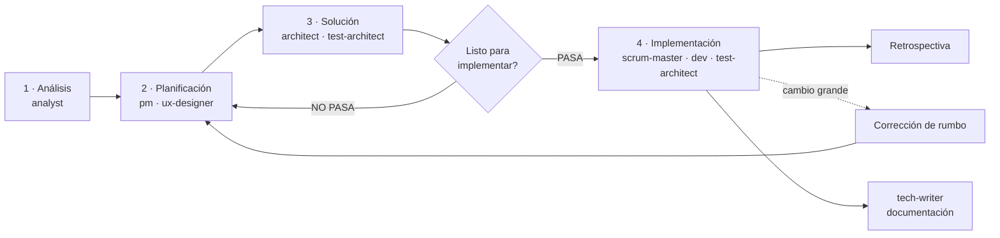

# Método de trabajo con agentes (adaptación de BMAD)

Este repo reúne el método con el que se desarrollan todos los proyectos: un equipo de agentes con roles definidos, los flujos que siguen, las plantillas de cada documento y los checklists de calidad. Está inspirado en [BMad Method](https://github.com/bmad-code-org/BMAD-METHOD) 6.12 y adaptado al español. El código de cada producto vive en su propio repo.

## Cómo se usa
1. En la sesión, conectá **este repo y el del proyecto**.
2. Pedí el trabajo de forma natural ("agregá X a RentHub", "hay un bug en Turnomator"). La skill `flujo-bmad` decide qué tan largo es el camino y coordina a los agentes.
3. Los documentos que se generan (brief, PRD, historias, etc.) quedan en el repo del proyecto. Este repo no guarda nada de ningún proyecto.

## Los tres caminos
Se elige el camino más corto que sea seguro para el cambio.

| Camino | Cuándo | Recorrido |
|---|---|---|
| **Rápido** | Un bug, un ajuste o una mejora chica: pocos archivos, sin cambios de arquitectura | `quick-dev` → revisión de `dev` → control de `test-architect` |
| **Estándar** | Una funcionalidad clara que entra en una o pocas historias | Especificación → historias → ciclo de construcción por historia |
| **Completo** | Producto o épica nueva, o requisitos todavía difusos | Análisis → Planificación → Solución → Implementación |



## Contenido
| Carpeta | Qué tiene |
|---|---|
| `.claude/agents/` | Los 9 agentes: analyst, pm, ux-designer, architect, scrum-master, dev, test-architect, tech-writer, quick-dev |
| `.claude/skills/flujo-bmad/` | La skill de coordinación: elige el camino, lanza a los agentes y maneja los traspasos |
| `flujos/` | Paso a paso de cada fase y de los flujos especiales |
| `plantillas/` | Estructura de cada documento: brief, PRD, UX, arquitectura, ADR, especificación, épica, historia, estado del sprint, plan de pruebas, retrospectiva, contexto del proyecto |
| `checklists/` | Listo para implementar, historia lista, definición de terminado, revisión de código, control de calidad |
| `original/v6.12/` | Copia sin cambios de BMad Method 6.12.4 (MIT), para consulta y actualización |

## Usar el BMAD original en un proyecto
El original no se puede usar desde este repo: se instala dentro de cada proyecto (crea `_bmad/` y sus skills) y necesita Node y [uv](https://docs.astral.sh/uv/). Si algún día lo querés en un proyecto:

```bash
npx bmad-method@6.12 install
```

Ver `NOTICE.md` para el origen y las marcas.
