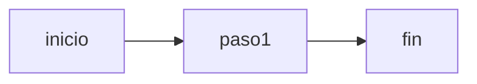

# Especificación de UX: {funcionalidad}

**Requisitos que cubre:** FR…

## Recorridos de usuario

## Pantallas
### {Pantalla}
- **Propósito:**
- **Componentes** (reutilizados / nuevos):
- **Estados:** vacío · cargando · error · éxito
- **Textos:**
- **Móvil:**

## Accesibilidad
Contraste, foco, lectores de pantalla, tamaño de toque.

## Decisiones de diseño
| Decisión | Alternativas | Motivo |
|---|---|---|

## Pendientes
